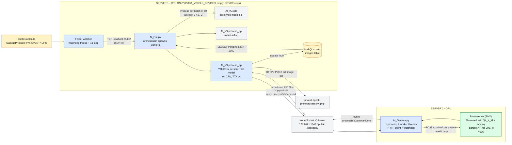
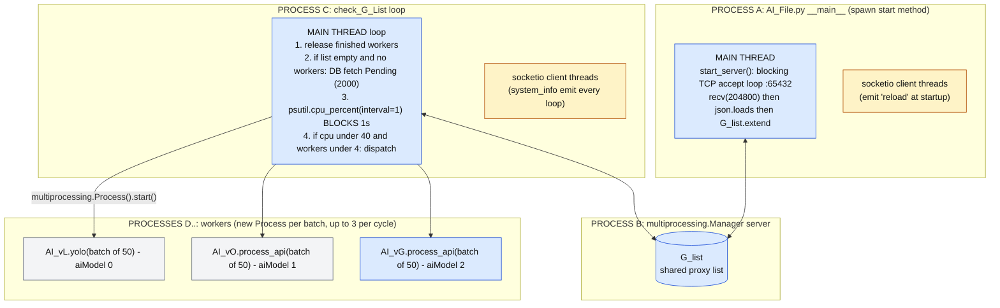
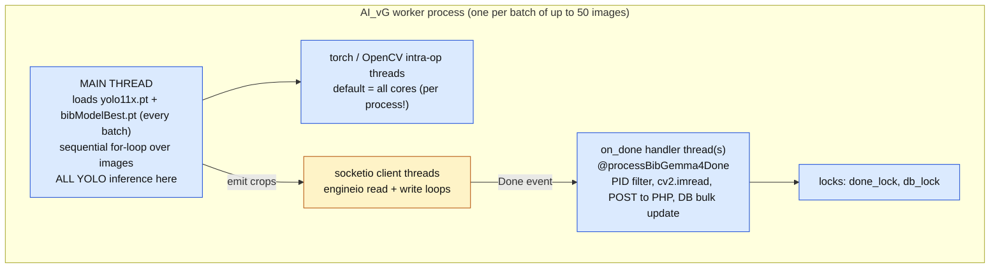
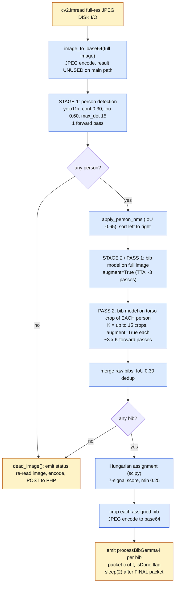
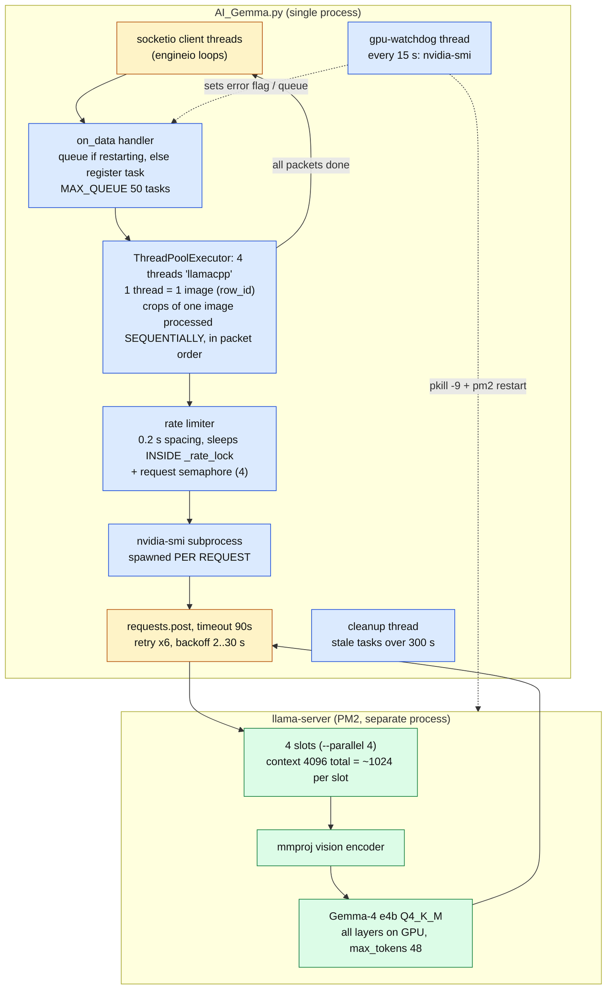
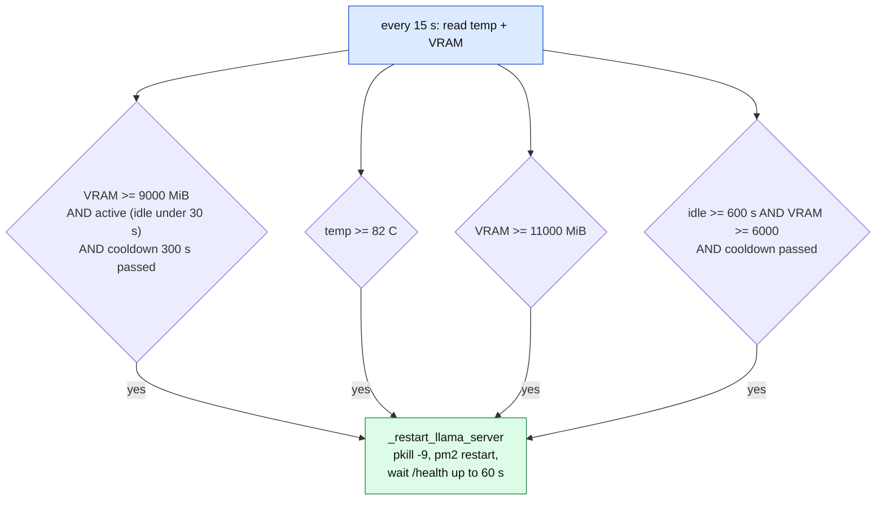
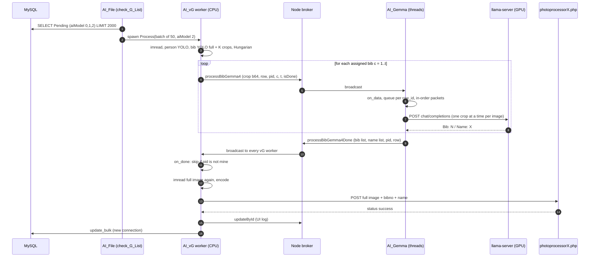

# AI-server-architecture
# Bib Detection + OCR Pipeline: Architecture

Scope: Server 1 (CPU: orchestrator + YOLO), Server 2 (GPU: Gemma via llama.cpp), the Socket.IO broker between them, MySQL, and the PHP photo server.

Legend used in all diagrams:

| Colour | Meaning |
|---|---|
| Blue | CPU work |
| Green | GPU work |
| Amber | Disk / DB / network I/O |

---

## 1. Big picture: where CPU and GPU are used

**Key fact:** the only GPU work in the whole system is `llama-server` on Server 2. All YOLO inference (person + bib, up to ~17 forward-pass groups per image) runs on Server 1 CPU.

---

## 2. Server 1: processes and threads

### Inside one `AI_vG` worker process

---

## 3. Per-image pipeline in `AI_vG` (all CPU)

**Forward-pass budget per image (CPU):** 1 person pass (yolo11x, largest YOLO11 variant) + 3 (full-image bib TTA) + 3 x K (crop bib TTA). With K = 5 runners that is about 19 passes per image, all serial in one thread.

---

## 4. Server 2: `AI_Gemma.py` and llama-server

### GPU watchdog rules

Only the 9000 MiB and idle rules honour the 300 s cooldown. The temp and critical-VRAM rules can restart repeatedly.

---

## 5. End-to-end sequence for one image

---

## 6. Resource usage matrix

| Stage | Where | Resource | Threads / procs | Notes |
|---|---|---|---|---|
| Folder watch | Server 1 | CPU (light), inotify | 1 watchdog thread + main loop (1 s) | |
| DB poll | Server 1 `check_G_List` proc | MySQL | main thread | New connection each call, never closed |
| CPU gate | Server 1 `check_G_List` proc | CPU | main thread | `cpu_percent(interval=1)` blocks 1 s each loop |
| Image read | vG worker | Disk I/O | main thread | Full image read in worker AND again in `on_done` |
| Person YOLO11x | vG worker | **CPU** | main + OpenMP threads | Model loaded |
| Bib YOLO, full image, TTA | vG worker | **CPU** | main + OpenMP threads | ~3 passes |
| Bib YOLO, per-person crops, TTA | vG worker | **CPU** | main + OpenMP threads | ~3 x K passes, dominant cost |
| Hungarian assign | vG worker | CPU (tiny) | main | |
| Crop encode + emit | vG worker | CPU + network | main + sio threads | base64 JPEG through broker |
| Broker fan-out | Node | CPU + network | n/a | Broadcast, every client gets every packet |
| Packet routing | Gemma proc | CPU | sio thread + 4 pool threads | |
| nvidia-smi temp check | Gemma proc | CPU (process spawn) | per request | Once per crop |
| Vision encode + LLM decode | llama-server | **GPU** | 4 slots | Only GPU use in system |
| OCR result post | vG `on_done` thread | CPU + network | handler thread | Re-reads and encodes full image |
| DB bulk update | vG `on_done` thread | MySQL | handler thread | New connection per call |

---

## 7. Concurrency limits (the numbers that cap throughput)

| Knob | Value | Effect |
|---|---|---|
| `batchSize` | 50 per aiModel per cycle | Rows per worker process |
| Dispatch gate | `cpu < 40%` and `len(process_list) < 4` | Up to 3 new procs per cycle, so list can exceed 4. `MAX_PROCS`  |
| vG workers in parallel | up to ~3-6 total across vL/vO/vG | Each uses all cores for torch |
| `PERSON_MAX_DET` | 15 | Max crops per image |
| `WORKER_THREADS` (Gemma) | 4 | 4 images in parallel, 1 crop in flight each |
| `--parallel` (llama) | 4 | Matches the 4 worker threads |
| `MIN_REQUEST_INTERVAL` | 0.2 s | Caps request starts at 5/s |
| `MAX_QUEUE` | 50 tasks | Excess images are dropped with no Done event |
| `LLAMA_TIMEOUT` / retries | 90 s / 6 | Worst case per crop is minutes |
| `-c 4096`, parallel 4 | ~1024 ctx per slot | Prompt + image tokens + 48 out must fit |

---

## 8. Optimization candidates

| # | Lever | Where | Expected impact | Risk |
|---|---|---|---|---|
| 1 | YOLO inference to GPU (TensorRT/ONNX-GPU, ideally on  a GPU on Server 1) | vG |  CPU YOLO is the bottleneck | 
| 2 | Turn off `augment=True` on pass 2 (or both) | vG | ~3x fewer bib passes | Small recall drop, test on hard images |
| 3 | Smaller person model (yolo11m/l)  | vG | Large CPU saving | 
| 4 | Persistent worker pool, load models once | AI_File / vG | 
| 5 | Targeted emits / rooms instead of broadcast; avoid base64 over broker | Broker | Less network + parse load | Broker change |
| 6 | One shared MySQL connection (or pool), close after use | DB | Fewer leaked connections | None |
| 7 | Revisit `-c 4096` with 4 slots | llama | Avoid silent truncation | VRAM use |

---

